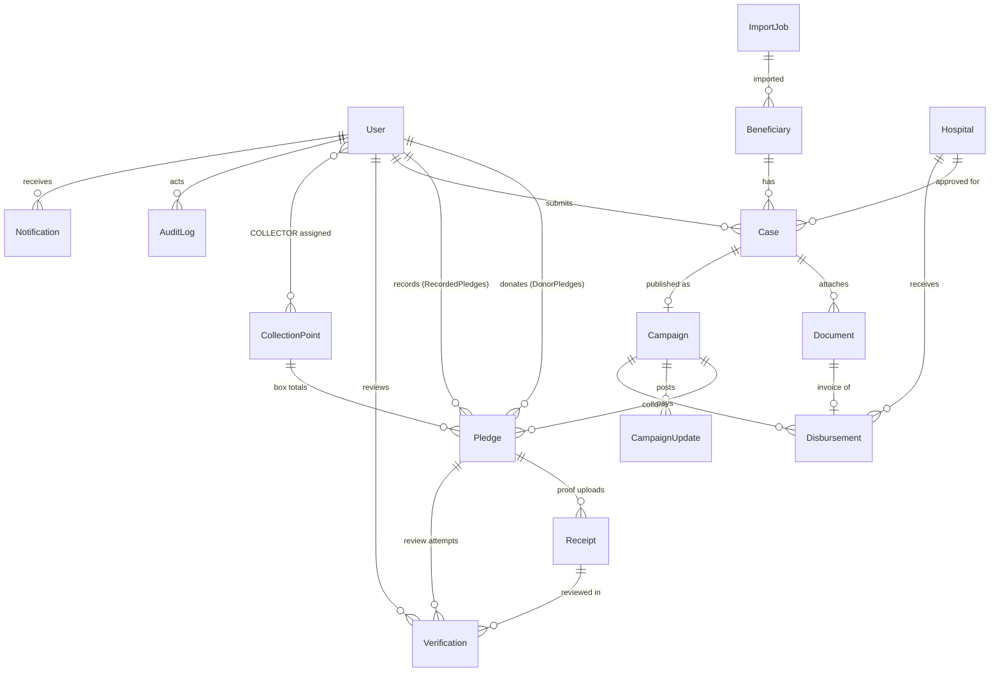
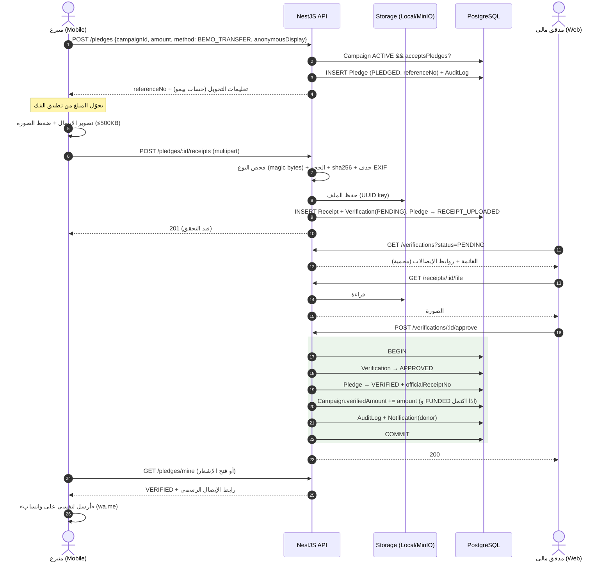

# التصميم التقني — مجلس فند

> مبني على `requirements.md` والـTech Stack المحسوم في `CLAUDE.md`. المراجع بين قوسين (FR-xx / NFR-xx) تشير إلى `requirements.md`.

## 0. قرارات الإصدارات

| الأداة | الإصدار | السبب |
|---|---|---|
| Node.js | 24 | المثبّت على جهاز التطوير |
| pnpm | 10 | workspaces |
| Turborepo | 2.x | تشغيل المهام عبر الحزم |
| TypeScript | 5.9 | مستقر ومتوافق مع أدوات NestJS/Next/Expo (TS 7 الجديد ما زال يحتاج تحقق توافق) |
| NestJS | 11 | API مستقر |
| Prisma | 6.19 | API مستقر (Prisma 7+ غيّر طريقة الإعداد) |
| PostgreSQL | 16 في docker-compose (يعمل أيضاً مع 18 محلياً) | |
| Next.js | 15.5 (App Router) + React 19 | next-intl 4 متوافق |
| Expo | SDK الحالي (عبر `create-expo-app`) | تطبيق Expo Go على الهواتف يدعم آخر SDK فقط |
| Zod | 3.25 | schemas مشتركة |

---

## 1. هيكل الـMonorepo

```
majlis-fund/
├── apps/
│   ├── api/                         # NestJS + Prisma
│   │   ├── prisma/
│   │   │   ├── schema.prisma
│   │   │   ├── migrations/
│   │   │   └── seed.ts
│   │   ├── src/
│   │   │   ├── main.ts              # bootstrap + Swagger + ValidationPipe
│   │   │   ├── app.module.ts
│   │   │   ├── common/              # guards, decorators, filters, pipes
│   │   │   │   ├── decorators/      # @Roles(), @CurrentUser(), @Public()
│   │   │   │   ├── guards/          # JwtAuthGuard, RolesGuard
│   │   │   │   └── utils/           # money, reference numbers
│   │   │   ├── prisma/              # PrismaModule/PrismaService
│   │   │   ├── storage/             # StorageService (local | MinIO)
│   │   │   ├── audit/               # AuditService
│   │   │   ├── auth/
│   │   │   ├── users/
│   │   │   ├── hospitals/
│   │   │   ├── collection-points/
│   │   │   ├── beneficiaries/
│   │   │   ├── cases/
│   │   │   ├── campaigns/           # + campaign updates
│   │   │   ├── pledges/             # + receipts upload
│   │   │   ├── verifications/
│   │   │   ├── disbursements/
│   │   │   ├── imports/
│   │   │   └── notifications/
│   │   ├── uploads/                 # local storage (gitignored)
│   │   └── test/
│   ├── web/                         # Next.js App Router
│   │   ├── messages/{ar,en}.json    # next-intl
│   │   ├── src/
│   │   │   ├── app/[locale]/
│   │   │   │   ├── page.tsx                     # الحملات (عام)
│   │   │   │   ├── campaigns/[slug]/page.tsx    # تفاصيل + OG + مشاركة
│   │   │   │   ├── receipts/[no]/page.tsx       # الإيصال الرسمي
│   │   │   │   ├── track/page.tsx               # تتبع الطلب (Stretch)
│   │   │   │   ├── login/page.tsx
│   │   │   │   └── dashboard/
│   │   │   │       ├── finance/                 # FINANCE_VERIFIER
│   │   │   │       ├── cases/                   # CASE_OFFICER
│   │   │   │       ├── intake/                  # STAFF
│   │   │   │       ├── collector/               # COLLECTOR
│   │   │   │       └── imports/                 # STAFF/ADMIN
│   │   │   ├── i18n/                # routing + request config
│   │   │   ├── lib/                 # api client, auth (cookies), format
│   │   │   └── components/
│   │   └── middleware.ts            # next-intl locale routing
│   └── mobile/                      # Expo (expo-router)
│       ├── app/
│       │   ├── (tabs)/index.tsx     # الحملات
│       │   ├── (tabs)/donations.tsx # تبرعاتي
│       │   ├── campaign/[slug].tsx
│       │   ├── pledge/[campaignId].tsx
│       │   ├── receipt/[pledgeId].tsx   # تصوير/رفع الإيصال
│       │   └── login.tsx
│       └── src/{api,i18n,components}/
├── packages/
│   ├── shared/                      # enums + Zod schemas + types + i18n keys
│   │   └── src/{enums,schemas,types,constants}.ts
│   ├── eslint-config/               # إعدادات ESLint مشتركة
│   └── tsconfig/                    # base / nest / next / expo
├── docker-compose.yml               # postgres + minio
├── turbo.json
├── pnpm-workspace.yaml
└── package.json
```

**قواعد:**
- `packages/shared` لا يعتمد على NestJS أو React؛ يُستهلك من الثلاثة.
- الـenums في `shared` تطابق enums الـPrisma حرفياً (يُفحص بـtest صغير في الـAPI).
- DTOs الخاصة بالـAPI (class-validator) تبقى في `apps/api` لأنها تعتمد على decorators؛ الـZod schemas المشتركة تُستخدم في الويب والموبايل للـvalidation في النماذج.

---

## 2. Prisma Schema

**ملاحظات تصميم:**
- `Role` هو **enum** لا جدول: الأدوار ثابتة ومعروفة، والـenum يُشارك مع الويب والموبايل وتستخدمه الـguards مباشرة. كل مستخدم له دور واحد.
- المبالغ `Decimal(14,2)` مع `Currency`؛ لا `Float` للمال.
- `Campaign.verifiedAmount` و`disbursedAmount` مخزّنان (cache) ويُحدَّثان **داخل transaction** مع قرار التحقق/الصرف. المبلغ «بانتظار التحقق» يُحسب بـaggregate.
- الرقم الوطني لا يُخزَّن نصاً: `nationalIdHash` (HMAC-SHA256 بمفتاح من البيئة) + `nationalIdLast4` (NFR-01).

```prisma
generator client {
  provider = "prisma-client-js"
}

datasource db {
  provider = "postgresql"
  url      = env("DATABASE_URL")
}

// ───────────── Enums ─────────────

enum Role {
  DONOR
  CASE_OFFICER
  FINANCE_VERIFIER
  STAFF
  ADMIN
  COLLECTOR
}

enum Locale {
  ar
  en
}

enum Currency {
  SYP
  USD
}

/// MEDICAL فقط حالياً؛ القيم المستقبلية تُضاف هنا (NFR-07)
enum CampaignType {
  MEDICAL
}

enum CampaignStatus {
  DRAFT
  ACTIVE
  FUNDED
  COMPLETED
  CLOSED
}

enum CaseCategory {
  SURGERY
  MEDICATION
  INCUBATOR
  ONCOLOGY
  TRANSPORT
  OTHER
}

enum CaseStatus {
  SUBMITTED
  UNDER_REVIEW
  NEEDS_INFO
  APPROVED
  REJECTED
  PUBLISHED
  CLOSED
}

enum CaseRoute {
  CROWDFUNDING
  AGA_KHAN_REFERRAL
  MONTHLY_BUDGET
}

enum Priority {
  VERY_URGENT
  URGENT
  NORMAL
}

enum DocumentKind {
  MEDICAL_REPORT
  ID_DOCUMENT
  HOSPITAL_QUOTE
  HOSPITAL_INVOICE
  OTHER
}

enum PledgeChannel {
  PLATFORM
  COUNCIL
  COLLECTOR
}

enum PaymentMethod {
  BEMO_TRANSFER
  BANK_TRANSFER
  E_WALLET
  CASH
  SHAM_CASH // محاكاة فقط حالياً
  PAYPAL    // محاكاة فقط
  VISA      // محاكاة فقط
}

enum PledgeStatus {
  PLEDGED
  RECEIPT_UPLOADED
  COLLECTED
  VERIFIED
  REJECTED
  CANCELLED
}

enum VerificationStatus {
  PENDING
  APPROVED
  REJECTED
}

enum ImportKind {
  BENEFICIARIES
}

enum ImportStatus {
  PREVIEW
  COMMITTED
  FAILED
}

// ───────────── Models ─────────────

model User {
  id               String   @id @default(cuid())
  fullName         String
  phone            String   @unique
  email            String?  @unique
  passwordHash     String?
  role             Role     @default(DONOR)
  locale           Locale   @default(ar)
  isActive         Boolean  @default(true)
  localCouncil     String?
  refreshTokenHash String?
  createdAt        DateTime @default(now())
  updatedAt        DateTime @updatedAt

  pledges          Pledge[]           @relation("DonorPledges")
  recordedPledges  Pledge[]           @relation("RecordedPledges")
  receipts         Receipt[]
  verifications    Verification[]
  submittedCases   Case[]             @relation("SubmittedCases")
  reviewedCases    Case[]             @relation("ReviewedCases")
  campaigns        Campaign[]
  documents        Document[]
  disbursements    Disbursement[]
  campaignUpdates  CampaignUpdate[]
  collectionPoints CollectionPoint[]  @relation("CollectorPoints")
  auditLogs        AuditLog[]
  importJobs       ImportJob[]
  notifications    Notification[]
}

model Beneficiary {
  id              String   @id @default(cuid())
  fullName        String
  phone           String?
  nationalIdHash  String?
  nationalIdLast4 String?
  localCouncil    String?
  otherPrograms   String[]
  isSuspended     Boolean  @default(false)
  suspensionNote  String?
  importJobId     String?
  createdAt       DateTime @default(now())
  updatedAt       DateTime @updatedAt

  cases     Case[]
  importJob ImportJob? @relation(fields: [importJobId], references: [id])

  @@index([nationalIdHash])
  @@index([phone])
}

model Hospital {
  id        String  @id @default(cuid())
  nameAr    String
  nameEn    String?
  city      String
  isPrivate Boolean @default(false)
  isActive  Boolean @default(true)

  cases         Case[]
  campaigns     Campaign[]
  disbursements Disbursement[]
}

model Case {
  id              String       @id @default(cuid())
  trackingNo      String       @unique
  beneficiaryId   String
  category        CaseCategory
  description     String // داخلي: الوصف الكامل
  requestedAmount Decimal      @db.Decimal(14, 2)
  currency        Currency     @default(SYP)
  status          CaseStatus   @default(SUBMITTED)
  priority        Priority?
  route           CaseRoute?
  hospitalId      String?
  doctorName      String?
  approvedAmount  Decimal?     @db.Decimal(14, 2)
  isAnonymous     Boolean      @default(true)
  redactedSummary String? // ما يظهر للعامة
  rejectionReason String?
  submittedById   String
  reviewedById    String?
  reviewedAt      DateTime?
  slaDueAt        DateTime?
  createdAt       DateTime     @default(now())
  updatedAt       DateTime     @updatedAt

  beneficiary Beneficiary @relation(fields: [beneficiaryId], references: [id])
  hospital    Hospital?   @relation(fields: [hospitalId], references: [id])
  submittedBy User        @relation("SubmittedCases", fields: [submittedById], references: [id])
  reviewedBy  User?       @relation("ReviewedCases", fields: [reviewedById], references: [id])
  documents   Document[]
  campaign    Campaign?

  @@index([status, priority])
}

model Campaign {
  id              String         @id @default(cuid())
  slug            String         @unique
  type            CampaignType   @default(MEDICAL)
  caseId          String?        @unique
  isOngoing       Boolean        @default(false)
  titleAr         String
  titleEn         String?
  summaryAr       String
  summaryEn       String?
  priority        Priority       @default(NORMAL)
  targetAmount    Decimal        @db.Decimal(14, 2)
  currency        Currency       @default(SYP)
  hospitalId      String?
  status          CampaignStatus @default(DRAFT)
  acceptsPledges  Boolean        @default(true)
  verifiedAmount  Decimal        @default(0) @db.Decimal(14, 2)
  disbursedAmount Decimal        @default(0) @db.Decimal(14, 2)
  publishedAt     DateTime?
  createdById     String
  createdAt       DateTime       @default(now())
  updatedAt       DateTime       @updatedAt

  case          Case?            @relation(fields: [caseId], references: [id])
  hospital      Hospital?        @relation(fields: [hospitalId], references: [id])
  createdBy     User             @relation(fields: [createdById], references: [id])
  pledges       Pledge[]
  updates       CampaignUpdate[]
  disbursements Disbursement[]

  @@index([status, type, priority])
}

model Document {
  id           String       @id @default(cuid())
  kind         DocumentKind
  caseId       String?
  storageKey   String       @unique
  originalName String
  mimeType     String
  sizeBytes    Int
  sha256       String
  uploadedById String
  createdAt    DateTime     @default(now())

  case         Case?         @relation(fields: [caseId], references: [id])
  uploadedBy   User          @relation(fields: [uploadedById], references: [id])
  disbursement Disbursement?
}

model CollectionPoint {
  id        String   @id @default(cuid())
  name      String // اسم المسجد/النقطة
  mukhiName String?
  area      String
  isActive  Boolean  @default(true)
  createdAt DateTime @default(now())

  collectors User[]   @relation("CollectorPoints")
  pledges    Pledge[]
}

model Pledge {
  id                 String        @id @default(cuid())
  referenceNo        String        @unique
  campaignId         String
  donorId            String?
  donorName          String?
  donorPhone         String?
  isAnonymousDisplay Boolean       @default(false)
  amount             Decimal       @db.Decimal(14, 2)
  currency           Currency
  channel            PledgeChannel
  method             PaymentMethod
  status             PledgeStatus
  isDemo             Boolean       @default(false)
  collectionPointId  String?
  recordedById       String?
  officialReceiptNo  String?       @unique
  verifiedAt         DateTime?
  createdAt          DateTime      @default(now())
  updatedAt          DateTime      @updatedAt

  campaign        Campaign         @relation(fields: [campaignId], references: [id])
  donor           User?            @relation("DonorPledges", fields: [donorId], references: [id])
  recordedBy      User?            @relation("RecordedPledges", fields: [recordedById], references: [id])
  collectionPoint CollectionPoint? @relation(fields: [collectionPointId], references: [id])
  receipts        Receipt[]
  verifications   Verification[]

  @@index([campaignId, status])
  @@index([donorId])
}

model Receipt {
  id           String   @id @default(cuid())
  pledgeId     String
  storageKey   String   @unique
  mimeType     String
  sizeBytes    Int
  sha256       String
  transferRef  String?
  uploadedById String
  createdAt    DateTime @default(now())

  pledge        Pledge         @relation(fields: [pledgeId], references: [id])
  uploadedBy    User           @relation(fields: [uploadedById], references: [id])
  verifications Verification[]

  @@index([sha256])
}

model Verification {
  id         String             @id @default(cuid())
  pledgeId   String
  receiptId  String?
  status     VerificationStatus @default(PENDING)
  reviewerId String?
  reason     String?
  createdAt  DateTime           @default(now())
  decidedAt  DateTime?

  pledge   Pledge   @relation(fields: [pledgeId], references: [id])
  receipt  Receipt? @relation(fields: [receiptId], references: [id])
  reviewer User?    @relation(fields: [reviewerId], references: [id])

  @@index([status, createdAt])
}

model Disbursement {
  id                String   @id @default(cuid())
  campaignId        String
  hospitalId        String
  amount            Decimal  @db.Decimal(14, 2)
  currency          Currency
  invoiceDocumentId String   @unique
  note              String?
  paidAt            DateTime
  recordedById      String
  createdAt         DateTime @default(now())

  campaign        Campaign @relation(fields: [campaignId], references: [id])
  hospital        Hospital @relation(fields: [hospitalId], references: [id])
  invoiceDocument Document @relation(fields: [invoiceDocumentId], references: [id])
  recordedBy      User     @relation(fields: [recordedById], references: [id])
}

model CampaignUpdate {
  id         String   @id @default(cuid())
  campaignId String
  authorId   String
  bodyAr     String
  bodyEn     String?
  createdAt  DateTime @default(now())

  campaign Campaign @relation(fields: [campaignId], references: [id])
  author   User     @relation(fields: [authorId], references: [id])
}

model AuditLog {
  id         String   @id @default(cuid())
  actorId    String?
  action     String // مثل: case.approve, pledge.verify, campaign.hospital_change
  entityType String
  entityId   String
  before     Json?
  after      Json?
  createdAt  DateTime @default(now())

  actor User? @relation(fields: [actorId], references: [id])

  @@index([entityType, entityId])
}

model ImportJob {
  id          String       @id @default(cuid())
  kind        ImportKind
  status      ImportStatus @default(PREVIEW)
  fileName    String
  storageKey  String?
  mapping     Json?
  totalRows   Int          @default(0)
  validRows   Int          @default(0)
  errorRows   Int          @default(0)
  errors      Json?
  createdById String
  createdAt   DateTime     @default(now())
  committedAt DateTime?

  createdBy     User          @relation(fields: [createdById], references: [id])
  beneficiaries Beneficiary[]
}

model Notification {
  id        String    @id @default(cuid())
  userId    String
  type      String
  title     String
  body      String
  link      String?
  readAt    DateTime?
  createdAt DateTime  @default(now())

  user User @relation(fields: [userId], references: [id])

  @@index([userId, readAt])
}
```

### ERD



### آلات الحالة (State machines)

**Pledge:**
```
PLATFORM / COUNCIL:  PLEDGED → RECEIPT_UPLOADED → VERIFIED
                                     ↓  ↑ (إعادة رفع)
                                  REJECTED
COLLECTOR:           COLLECTED → VERIFIED | REJECTED
COUNCIL (كاش باليد):  COLLECTED → VERIFIED | REJECTED
أي حالة قبل VERIFIED → CANCELLED (بطلب المتبرع)
```

**Case:**
```
SUBMITTED → UNDER_REVIEW → APPROVED → PUBLISHED → CLOSED
                ↓    ↑         ↓
           NEEDS_INFO      (تغيير مشفى / زيادة مبلغ) → UNDER_REVIEW + campaign.acceptsPledges = false
                ↓
             REJECTED
```

---

## 3. موديولات NestJS والـEndpoints

**الصلاحيات:** `Public` = بدون تسجيل دخول. `Auth` = أي مستخدم مسجّل. كل endpoint محمي بـ`JwtAuthGuard` + `RolesGuard` افتراضياً (global)، والعامة تُعلَّم بـ`@Public()`. كل endpoint موثق بـSwagger (`@ApiTags`, `@ApiOperation`, `@ApiResponse`, DTOs بـ`@ApiProperty`).

### auth
| Method | Path | الصلاحية | الوصف |
|---|---|---|---|
| POST | `/auth/register` | Public | تسجيل متبرع (`DONOR`): الاسم، الهاتف، كلمة المرور |
| POST | `/auth/login` | Public | هاتف + كلمة مرور ← access + refresh tokens |
| POST | `/auth/refresh` | Public (refresh token) | تجديد الـaccess token |
| POST | `/auth/logout` | Auth | إبطال الـrefresh token |
| GET | `/auth/me` | Auth | المستخدم الحالي |

### users
| GET | `/users` | ADMIN | قائمة المستخدمين |
|---|---|---|---|
| POST | `/users` | ADMIN | إنشاء موظف بأي دور |
| PATCH | `/users/:id` | ADMIN | تعديل الدور/التفعيل/نقاط الجمع |

### hospitals · collection-points
| GET | `/hospitals` | Auth | قائمة المشافي |
|---|---|---|---|
| POST/PATCH | `/hospitals` | ADMIN | إدارة المشافي |
| GET | `/collection-points` | ADMIN, FINANCE_VERIFIER, STAFF | كل النقاط |
| GET | `/collection-points/mine` | COLLECTOR | نقاطي فقط |
| POST/PATCH | `/collection-points` | ADMIN | إدارة النقاط وربط الـCOLLECTORs |

### beneficiaries
| POST | `/beneficiaries` | STAFF, ADMIN | تسجيل مستفيد (الرقم الوطني ← hash) |
|---|---|---|---|
| GET | `/beneficiaries/duplicates?nationalId=&phone=` | STAFF, CASE_OFFICER | كشف الازدواجية (FR-10) |
| GET | `/beneficiaries/:id` | STAFF, CASE_OFFICER | الملف + الطلبات السابقة |

### cases
| POST | `/cases` | STAFF | تقديم طلب (multipart: بيانات + تقرير طبي) |
|---|---|---|---|
| GET | `/cases` | STAFF, CASE_OFFICER, ADMIN | قائمة الانتظار (فلترة: status, priority, overdue) |
| GET | `/cases/:id` | STAFF, CASE_OFFICER, ADMIN | التفاصيل |
| POST | `/cases/:id/documents` | STAFF, CASE_OFFICER | إضافة وثيقة |
| POST | `/cases/:id/review` | CASE_OFFICER | approve / reject / needs_info + priority, route, hospital, doctor, approvedAmount |
| PATCH | `/cases/:id/hospital-amount` | CASE_OFFICER, ADMIN | تغيير المشفى/المبلغ ← إعادة للمراجعة (FR-09) |
| POST | `/cases/:id/publish` | CASE_OFFICER | إنشاء حملة من الحالة (redactedSummary إلزامي) |
| GET | `/cases/track?no=&phoneLast4=` | Public | تتبع الطلب (FR-12) |
| GET | `/documents/:id/file` | حسب الصلاحية | تنزيل وثيقة خاصة |

### campaigns
| GET | `/campaigns` | Public | الحملات النشطة (فلترة، pagination، verified + pending) |
|---|---|---|---|
| GET | `/campaigns/:slug` | Public | التفاصيل العامة (بدون بيانات شخصية) |
| GET | `/campaigns/:slug/og` | Public | بيانات المعاينة (للـOpen Graph) |
| POST | `/campaigns` | ADMIN | حملة مستمرة (بدون حالة، مثل مرضى السرطان) |
| PATCH | `/campaigns/:id/status` | ADMIN, CASE_OFFICER | إغلاق/إيقاف |
| POST | `/campaigns/:id/updates` | STAFF, CASE_OFFICER, ADMIN | تحديث «تمت العملية» |
| GET | `/campaigns/:id/transparency` | Public | المجمّع/المتحقق/المصروف (FR-23) |

### pledges
| POST | `/pledges` | DONOR | تعهد (PLATFORM) ← تعليمات التحويل + referenceNo |
|---|---|---|---|
| POST | `/pledges/council` | STAFF, FINANCE_VERIFIER | تبرع حضوري (COUNCIL)، الاسم والهاتف إلزاميان |
| POST | `/pledges/collector` | COLLECTOR | حصيلة نقطة جمع (COLLECTOR)، فقط لنقاطه |
| POST | `/pledges/demo` | DONOR (فقط مع `DEMO_MODE`) | محاكاة دفع فوري |
| GET | `/pledges/mine` | DONOR | «تبرعاتي» |
| GET | `/pledges/:id` | المالك أو FINANCE_VERIFIER/ADMIN | التفاصيل |
| POST | `/pledges/:id/receipts` | المالك (DONOR) أو STAFF | رفع إيصال (multipart) ← Verification PENDING |
| POST | `/pledges/:id/cancel` | المالك | إلغاء قبل التحقق |
| GET | `/receipts/:id/file` | المالك، FINANCE_VERIFIER، ADMIN | صورة الإيصال |
| GET | `/official-receipts/:no` | Public (برقم الإيصال) | الإيصال الرسمي (اسم المتبرع يظهر فقط إن لم يختر «فاعل خير») |

### verifications
| GET | `/verifications?status=PENDING` | FINANCE_VERIFIER | قائمة الانتظار (الأقدم أولاً) + الإيصال + التعهد |
|---|---|---|---|
| POST | `/verifications/:id/approve` | FINANCE_VERIFIER | transaction: pledge VERIFIED + campaign.verifiedAmount + officialReceiptNo + audit + notification |
| POST | `/verifications/:id/reject` | FINANCE_VERIFIER | سبب إلزامي ← pledge REJECTED + notification |
| POST | `/verifications/collected/:pledgeId` | FINANCE_VERIFIER | فتح تحقق لحصيلة COLLECTED/COUNCIL (لا إيصال) |

**قاعدة فصل الصلاحيات:** المدقق لا يعتمد تعهداً سجّله بنفسه (`pledge.recordedById !== reviewerId`).

### disbursements
| POST | `/disbursements` | FINANCE_VERIFIER | صرف للمشفى المعتمد فقط + فاتورة (multipart) |
|---|---|---|---|
| GET | `/campaigns/:id/disbursements` | Public (مختصر) / FINANCE_VERIFIER (كامل) | |

### imports
| POST | `/imports/preview` | STAFF, ADMIN | رفع xlsx/csv ← headers + أول 20 صف + jobId |
|---|---|---|---|
| POST | `/imports/:id/validate` | STAFF, ADMIN | mapping ← نتيجة dry-run (صالح/أخطاء/تكرار) |
| POST | `/imports/:id/commit` | STAFF, ADMIN | الحفظ في transaction |
| GET | `/imports/:id/errors.csv` | STAFF, ADMIN | الصفوف المرفوضة |

### notifications · audit
| GET | `/notifications` | Auth | إشعاراتي |
|---|---|---|---|
| POST | `/notifications/:id/read` | Auth | |
| GET | `/audit?entityType=&entityId=` | ADMIN | سجل التدقيق |

---

## 4. Sequence: تعهد ← إيصال ← تحقق ← رصيد ← إشعار



**الإشعار في الـMVP:** سجل `Notification` داخل التطبيق + رابط `wa.me` جاهز (للمتبرع أو للموظف). لا WhatsApp API ولا push notifications في الهاكاثون.

---

## 5. توزيع الشاشات

| الشاشة | الموبايل (Expo) | الويب (Next.js) | الدور |
|---|---|---|---|
| تصفح الحملات + فلترة | ✓ | ✓ (عام، SSR، EN/AR) | عام |
| تفاصيل الحملة + مشاركة واتساب | ✓ | ✓ + Open Graph | عام |
| التعهد + تعليمات التحويل | ✓ (أساسي) | ✓ (للمغتربين من الكمبيوتر) | DONOR |
| تصوير/رفع الإيصال | ✓ (كاميرا) | ✓ (رفع ملف) | DONOR |
| «تبرعاتي» | ✓ | ✓ | DONOR |
| الإيصال الرسمي | رابط ← الويب | ✓ (قابل للطباعة) | عام برقم الإيصال |
| تتبع الطلب برقم | — | ✓ | عام |
| تسجيل حالة (intake) | — | ✓ | STAFF |
| قائمة الحالات + التقييم + النشر | — | ✓ | CASE_OFFICER |
| قائمة الإيصالات + الاعتماد/الرفض | — | ✓ | FINANCE_VERIFIER |
| تبرع حضوري | — | ✓ | STAFF / FINANCE_VERIFIER |
| تسجيل حصيلة نقطة الجمع | (لاحقاً) | ✓ (واجهة مبسطة، خط كبير) | COLLECTOR |
| الصرف للمشفى | — | ✓ | FINANCE_VERIFIER |
| استيراد Excel | — | ✓ | STAFF / ADMIN |
| إدارة المستخدمين/المشافي/النقاط | — | ✓ | ADMIN |

**ملاحظة:** واجهة `COLLECTOR` على الويب أولاً (responsive، تعمل من متصفح الهاتف)، حتى لا يحتاج المكي أو المتطوع تثبيت تطبيق.

---

## 6. خطة استيراد Excel/Access

**المكتبات:** `exceljs` لقراءة `.xlsx`، و`csv-parse` لـ`.csv` (مع ترميز UTF-8 وUTF-8 BOM؛ Excel العربي غالباً يحفظ CSV بـBOM).

**الخطوات:**

1. **`POST /imports/preview`** (multipart، حد 10 MB، ≤ 5,000 صف في الهاكاثون)
   - يقرأ أول ورقة؛ أول صف = العناوين.
   - ينشئ `ImportJob(status=PREVIEW)` ويخزن الملف مؤقتاً.
   - يرجع: `jobId`، `headers[]`، `sampleRows` (أول 20)، و**mapping مقترح** بمطابقة تقريبية للعناوين العربية/الإنكليزية (مثل «الاسم الكامل» / «الاسم» / `name` ← `fullName`).
2. **`POST /imports/:id/validate`** `{ mapping: { fullName: "الاسم", phone: "الموبايل", nationalId: "الرقم الوطني", localCouncil: "المجلس", otherPrograms: "البرامج" } }`
   - Dry run: Zod schema لكل صف (من `packages/shared`).
   - تطبيع: أرقام عربية ← لاتينية (`٠٩٤` ← `094`)، إزالة المسافات، صيغة الهاتف السوري.
   - كشف التكرار داخل الملف ومع قاعدة البيانات (hash الرقم الوطني أو الهاتف).
   - يرجع: `validRows`، `errorRows`، `duplicates`، وأول 50 خطأ `{row, field, message}`.
3. **`POST /imports/:id/commit`** ← `createMany` داخل transaction؛ الصفوف المكررة تُتخطى (لا تُستبدل)؛ `ImportJob → COMMITTED` + `AuditLog`.
4. **`GET /imports/:id/errors.csv`** ← الصفوف المرفوضة مع سبب كل منها، لتصحيحها وإعادة رفعها.

**الواجهة (ويب):** معالج من 3 خطوات: رفع ← مطابقة الأعمدة (قوائم منسدلة + معاينة حية) ← النتيجة والتأكيد.

**Access:** دليل مصور: Access ← External Data ← Export ← Excel، ثم نفس المسار.

---

## 7. خطة العمل للهاكاثون

**الافتراض:** 3 أعضاء (Backend / Web / Mobile). عدّل التوزيع إن اختلف العدد: مع عضوين يأخذ عضو الويب الموبايل بعد P1، ومع 4 أعضاء يُفصل «لوحات الموظفين» عن «الصفحات العامة».

**الترتيب:** P0 ← P1 ← P2. لا يبدأ أحد P2 قبل أن يعمل المسار الذهبي كاملاً.

| الأولوية | Backend | Web | Mobile |
|---|---|---|---|
| **P0: الأساس** | Monorepo، docker-compose، Prisma schema + seed، Auth + guards، Swagger | `packages/shared` (مع Backend)، i18n + RTL layout، api client، login | Expo setup، i18n + RTL، api client، login |
| **P1: المسار الذهبي** | campaigns (public)، pledges + receipts upload، verifications (transaction)، official receipts | صفحات الحملات العامة + OG، لوحة المدقق المالي، الإيصال الرسمي | قائمة الحملات، التفاصيل، التعهد، تصوير الإيصال، «تبرعاتي» |
| **P1: الحالات** | cases (intake/review/publish)، قفل المشفى والمبلغ، audit | لوحة تسجيل الحالة (STAFF) + لوحة المدقق (CASE_OFFICER) | مشاركة واتساب |
| **P2: إضافات** | collector + council pledges، disbursements، imports، duplicates، SLA | واجهة COLLECTOR، الصرف، معالج الاستيراد، الشفافية | محاكاة الدفع (Demo)، إشعارات داخلية |
| **P3: العرض** | seed بسيناريوهات العرض (15 ← 25 مليون) | Slow 3G، صقل التصميم | تجربة على جهازين |

**نقاط تزامن:** بعد P0 (تجميد الـschema والـenums في `shared`)، وبعد P1 (تجربة المسار الذهبي كاملاً من الموبايل إلى الويب).
