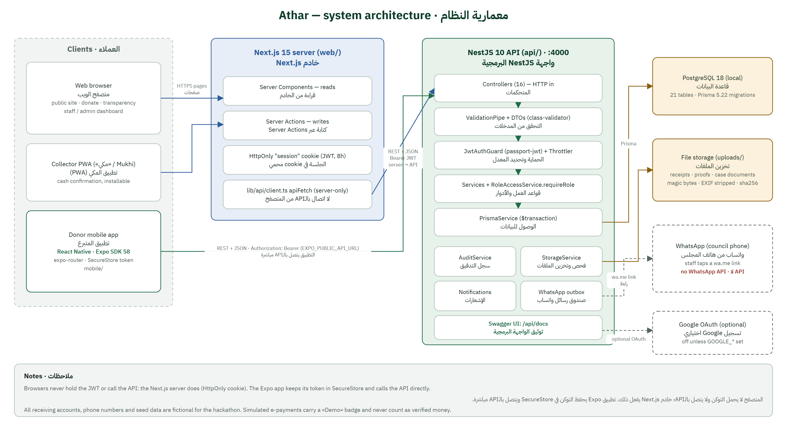
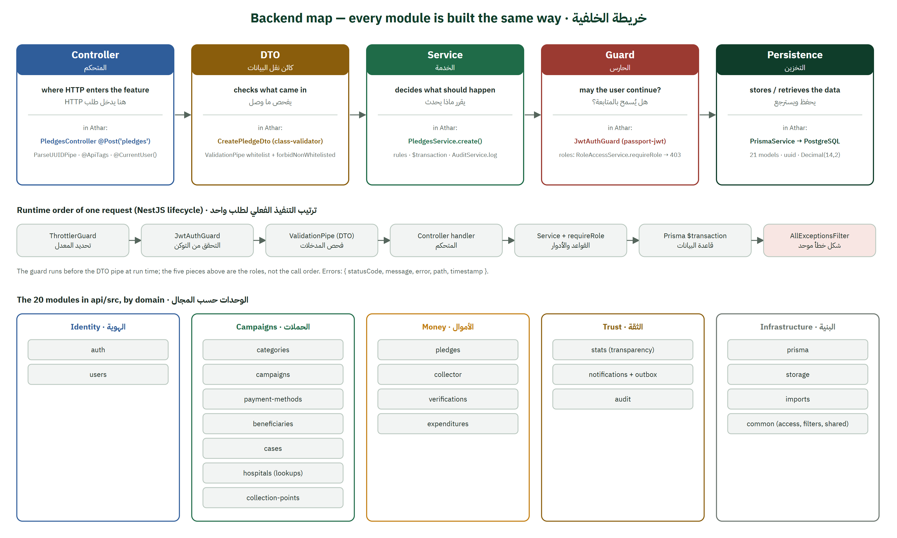
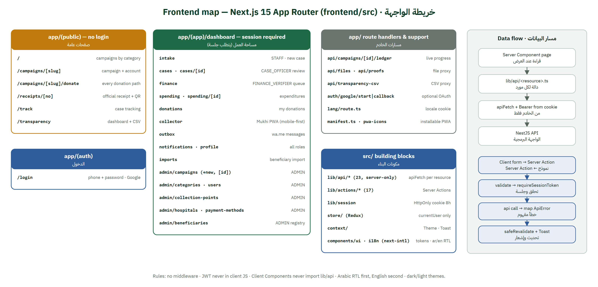
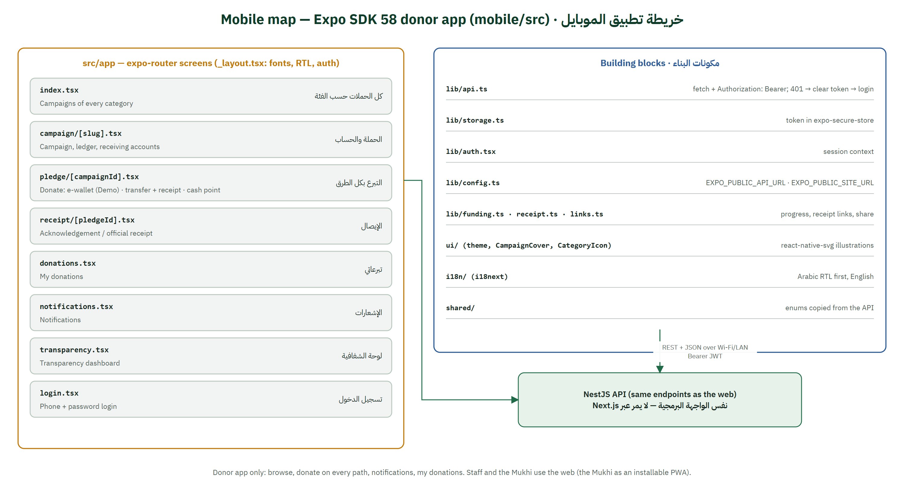
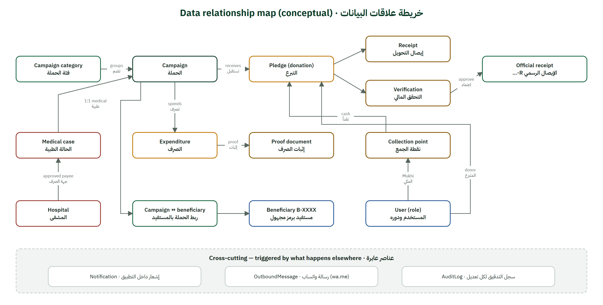
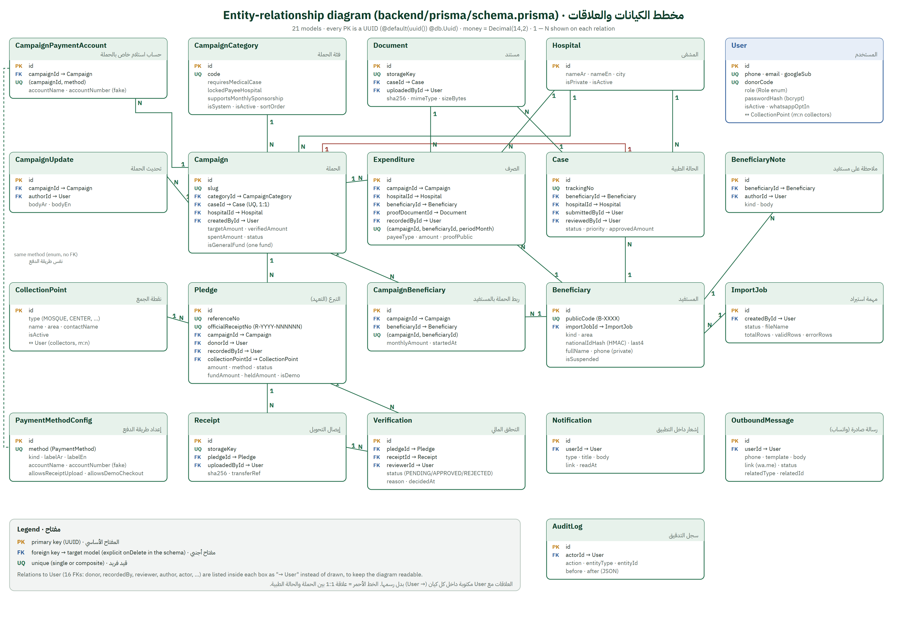
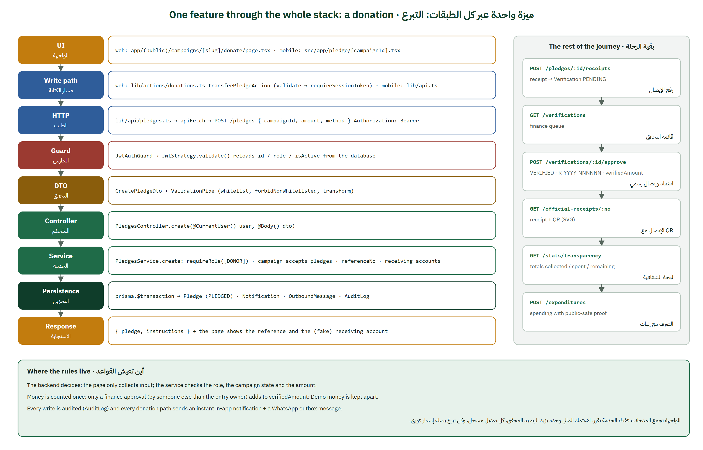
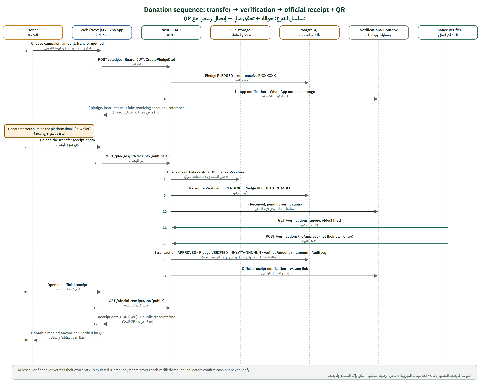
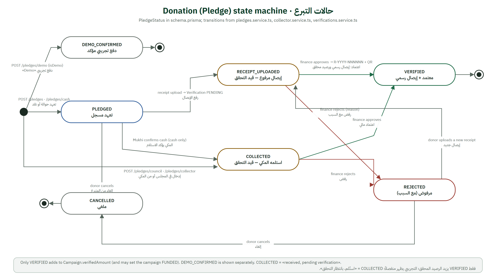

# أثر — خريطة بناء النظام (System Construction Map)

دليل للنظام الذي بنيناه للمجلس المحلي في السلمية: أجزاؤه، وكيف تترابط، وبأي ترتيب بنيناها، وكيف يمر تبرع واحد عبر
كل الطبقات. مكتوب على نمط «System Construction Map» الخاص بـ B4F Board، ومبني على الكود الفعلي لمستودع
`salamiyah-hackathon` (الفرع `main`، 23 تشرين الثاني 2026).

## 1. ماذا نبني فعلاً؟

**أثر (Athar)** هو فكرة الهاكاثون الرسمية لفريق «أثر» (الفكرة المعتمدة رقم 4): *أتمتة التبرعات للمجلس المحلي في سلمية*. وهو نظام
يعمل فعلاً وليس نموذجاً شكلياً:

- ينشئ المجلس **حملات تبرع** ضمن **فئات** مخزنة كبيانات (مساعدات طبية، كفالة أيتام، ترميم منازل، وأي فئة يضيفها
  المدير) مع **مبلغ مستهدف**.
- يتصفح **المتبرعون** الحملات على الويب أو **تطبيق الموبايل** ويتبرعون بحوالة بنكية مع صورة الإيصال، أو بمحفظة
  محلية (محاكاة مع شارة «Demo»)، أو **نقداً في نقطة جمع** يستلمها «المكي».
- يصل لكل تبرع **إشعار فوري** بتأكيد الاستلام، وبعد اعتماد **المدقق المالي** يصدر **إيصال رسمي** مع رمز QR.
- تعرض **لوحة الشفافية** العامة إجمالي ما جُمع، وما صُرف مع إثبات آمن للنشر، والمستفيدين برمز مجهول `B-XXXX` فقط
  دون أي كشف لهوياتهم.

| الجزء | التقنية | المجلد |
|---|---|---|
| الخلفية (Backend) | NestJS 10 · Prisma 5.22 · PostgreSQL | `api/` |
| الواجهة (Frontend) | Next.js 15 (App Router) · Tailwind 3 · next-intl | `web/` |
| الموبايل (Mobile) | React Native · Expo SDK 58 · expo-router | `mobile/` |
| أدوات هندسية | Swagger `/api/docs` · Postman v2.1 · Jest · Vitest · Playwright · Git | `docs/`، `e2e/` |

Swagger وPostman وGit والاختبارات أدوات نستخدمها أثناء البناء، وليست جزءاً من المنتج نفسه.

> واجهة التطبيق ما زالت تعرض الاسم السابق «مجلس فند»؛ تغيير الاسم قيد التنفيذ. ويظهر أيضاً في عنوان Swagger (`Majlis Fund API`) وشاشات العرض.

<!-- pagebreak -->

## 2. خريطة النظام كاملاً

- **الواجهة تتحدث مع الخلفية، والخلفية تملك القواعد.** لا شيء موثوق لمجرد أن الصفحة أرسلته: الـAPI يتحقق من
  التوكن والدور وحالة الحملة والمبلغ.
- **المتصفح لا يحمل الـJWT أبداً.** خادم Next.js يحفظه في cookie محمي (HttpOnly) ويتصل بالـAPI عبر `apiFetch`.
  تطبيق Expo يحفظ التوكن في SecureStore ويتصل بنفس الـAPI مباشرة.
- **كل وحدة في الخلفية تُبنى بالطريقة نفسها** (controller وDTOs وservice)، فأي مجال جديد يتبع نمطاً معروفاً وآمناً.
- **واتساب بلا API:** تُكتب الرسائل في صندوق صادر، ويرسلها الموظف بنقرة واحدة على رابط `wa.me`.

## 3. مِمَّ يتكون أثر؟

| جزء المنتج | الشاشات | أهم الـendpoints | أهم الجداول |
|---|---|---|---|
| الحملات حسب الفئة | الرئيسية، صفحة الحملة، إدارة الحملات والفئات | `GET /campaigns`، `POST /campaigns`، `/categories` | Campaign، CampaignCategory |
| حساب الحملة (الدفتر) | صفحة الحملة، شاشة الحملة في الموبايل | `GET /campaigns/:id/ledger`، `/payment-accounts` | Campaign، PaymentMethodConfig، CampaignPaymentAccount |
| التبرعات | صفحة التبرع، شاشة التبرع في الموبايل | `POST /pledges`، `/pledges/demo`، `/pledges/cash`، `/pledges/:id/receipts` | Pledge، Receipt |
| المكي | تطبيق المكي (PWA) | `/collector/points`، `/collector/pledges/:id/confirm` | CollectionPoint، Pledge |
| التحقق والإيصالات | قائمة التحقق المالي، صفحة الإيصال | `/verifications/:id/approve`، `/official-receipts/:no` | Verification، Pledge |
| الصرف | صفحات الصرف | `POST /expenditures`، `/campaigns/:id/expenditures/monthly` | Expenditure، Document |
| الشفافية | `/transparency`، شاشة الموبايل | `GET /stats/transparency(.csv)` | كل ما سبق مجمّعاً |
| الإشعارات | الجرس، صندوق الرسائل | `/notifications`، `/outbox` | Notification، OutboundMessage |
| المسار الطبي | الاستقبال، الحالات | `/cases`، `/cases/:id/review`، `/cases/:id/publish` | Case، Beneficiary، Hospital |
| الإدارة | شاشات الإعداد | `/users`، `/hospitals`، `/collection-points`، `/imports` | User، AuditLog، ImportJob |

<!-- pagebreak -->

## 4. مسار البناء

بنينا الخلفية أولاً، شريحة عمودية واحدة في كل مرة، وكل شريحة في فرعها (`p02`…`p24`)، ولا تُدمج في `main` إلا وlint
والاختبارات والبناء كلها ناجحة:

| الخطوة | الفرع | ما أضافته |
|---|---|---|
| 1 | `p02-api-skeleton` | هيكل NestJS على نسخ الـbootcamp، مخطط Prisma بمفاتيح uuid، أول migration وseed |
| 2 | `p03-auth-contract` | مصادقة passport-jwt، حراس على مستوى الـclass، `RoleAccessService` واختبارات الصلاحيات |
| 3 | `p04-web-skeleton` | هيكل Next.js: cookie الجلسة، `apiFetch`، ثيم السلمية، اللغة من cookie، الدخول |
| 4 | `p05`–`p06` | الفئات كبيانات، الصرف، رموز المستفيدين، إعداد طرق الدفع؛ واجهة دفتر الحملة |
| 5 | `p07`–`p09` | الصفحات العامة، مساحة الموظفين والمسار الطبي، تطبيق المتبرع Expo |
| 6 | `p10`–`p13` | كل طرق التبرع، الإشعارات الفورية وصندوق الرسائل، تطبيق المكي، الإيصالات الرسمية مع QR |
| 7 | `p14`–`p15` | الصرف مع إثباتات عامة، الكفالة الشهرية، لوحة الشفافية |
| 8 | `p16` | بيانات عرض ثابتة، `demo:reset`، `DEMO.md`، سيناريو Playwright |
| 9 | `p17`–`p24` | شاشات الإدارة، دورة حياة الحملة، سجل التدقيق وتنبيهات المهلة، الوضع الفاتح، دخول Google الاختياري، تسمية «مكي» |

**لماذا الخلفية أولاً؟** لأن الصفحات تحتاج عقداً حقيقياً تتحدث معه؛ ولأن الخلفية هي المرجع الموثوق لكل قاعدة (من
يحق له الاعتماد، وكم يجوز صرفه)؛ ولأن علاقات البيانات (حملة ← تبرع ← تحقق ← إيصال) يجب أن توجد قبل الشاشات التي
تعرضها.

<!-- pagebreak -->

## 5. خريطة الخلفية

- **Controller (المتحكم)** = حيث يدخل طلب HTTP. وحدة لكل مجال (`api/src/<domain>/`)، الـendpoints العامة في متحكمات
  بلا حارس، والمحمية عليها `@UseGuards(JwtAuthGuard)` و`@ApiBearerAuth()` على مستوى الـclass.
- **DTO** = يفحص ما وصل. `class-validator` و`@ApiProperty` على كل حقل؛ والـ`ValidationPipe` العام يرفض الحقول غير
  المعروفة؛ والمعرّفات تمر عبر `ParseUUIDPipe`.
- **Service (الخدمة)** = تقرر ماذا يحدث: قواعد العمل، و`prisma.$transaction` للكتابة على عدة صفوف، و`AuditService.log`
  عند كل تعديل، والإشعارات في كل مسار تبرع.
- **Guard (الحارس)** = يقرر هل يُسمح للمستخدم بالمتابعة. `JwtAuthGuard` يعيد تحميل المعرّف والدور وحالة الحساب من قاعدة
  البيانات؛ والأدوار تُفحص داخل الخدمات بـ`RoleAccessService.requireRole` (403)، وموارد الآخرين تُخفى بـ404.
- **Persistence (التخزين)** = يحفظ ويسترجع: `PrismaService` ← PostgreSQL، 21 جدولاً، مفاتيح UUID، المال بصيغة
  `Decimal(14,2)`، وتغيير المخطط عبر migrations فقط.
- الأخطاء بشكل واحد دائماً: `{ statusCode, message, error, path, timestamp }` مع رموز ثابتة في `message`.

<!-- pagebreak -->

## 6. خريطة الواجهة

- ثلاث مجموعات مسارات: `(public)` بلا دخول، و`(auth)` للدخول، و`(app)` تتطلب جلسة يُتحقق منها في الـlayout (بلا
  middleware). صفحات المكي تحت `(app)/dashboard/collector` وتُثبَّت كتطبيق PWA.
- **القراءة** في Server Components عبر `lib/api/<resource>.ts`، و**الكتابة** عبر Server Actions في
  `lib/actions/<resource>.ts` (تحقق ← `requireSessionToken()` ← الـAPI ← ترجمة `ApiError` ← تحديث). مكونات العميل لا
  تستورد `lib/api` أبداً.
- Redux لـ`currentUser` فقط، وContext للثيم والإشعارات المنبثقة فقط. العربية RTL أولاً ثم الإنجليزية، والوضعان
  الداكن والفاتح.

## 7. خريطة الموبايل

- تطبيق للمتبرع فقط: تصفح حملات كل الفئات، التبرع بكل الطرق، الإشعارات، تبرعاتي، شاشة الشفافية. التوكن في
  `expo-secure-store`، والطلبات بـ`Authorization: Bearer`، وعند 401 يُحذف التوكن ويعود للدخول.
- يستخدم نفس endpoints الخلفية التي يستخدمها الويب؛ و`EXPO_PUBLIC_API_URL` يشير إلى الـAPI على الشبكة المحلية في العرض.

<!-- pagebreak -->

## 8. خريطة علاقات البيانات

**الفئة** تضم **الحملات**؛ والحملة **تستقبل التبرعات**؛ وتبرع الحوالة يحمل **إيصالاً** يذهب إلى **التحقق المالي**؛
والاعتماد يصدر **الإيصال الرسمي** ويرفع المبلغ المحقق. والحملة **تصرف** عبر **سجلات الصرف** مع مستند إثبات، وترتبط
**بالمستفيدين** برمز مجهول. والحملة الطبية تأتي من **حالة طبية** واحدة مع **مشفى** معتمد. أما **الإشعارات** و**صندوق
واتساب** و**سجل التدقيق** فهي عناصر عابرة تُطلقها أحداث في أماكن أخرى. المخطط الكامل بكل المفاتيح الأساسية والأجنبية
في `docs/diagrams/erd.png`.

<!-- pagebreak -->

## 9. تبرع واحد عبر كل الطبقات

مبني ومختبَر من البداية للنهاية (Jest وVitest وPlaywright ومشغّل Postman): الصفحة، والـServer Action، وعميل الـAPI،
والحارس، والـDTO، والمتحكم، والخدمة، والمعاملة، والاستجابة؛ ثم رفع الإيصال، والاعتماد المالي، والإيصال الرسمي مع QR،
ومجاميع لوحة الشفافية.

<!-- pagebreak -->

## 10. حالات التبرع والوجهة النهائية

**ما بُني للهاكاثون:** الحملات حسب الفئة، كل طرق التبرع، الإشعارات الفورية، تأكيد المكي، التحقق المالي مع الإيصالات
الرسمية، الصرف مع إثبات عام، لوحة الشفافية، شاشات الإدارة، تطبيق المتبرع، بيانات عرض ثابتة، واختبار آلي كامل
لسيناريو لجنة التحكيم.

**نطاق مستقبلي (يُذكر فقط ولم يُبنَ):** السلال الغذائية، دعم التعليم، جمع صناديق نقاط الجمع الشهري، الاعتماد المشترك،
تحويلات الآغا خان، المطابقة الشهرية، بوابة دفع حقيقية، وواجهة WhatsApp Business.
