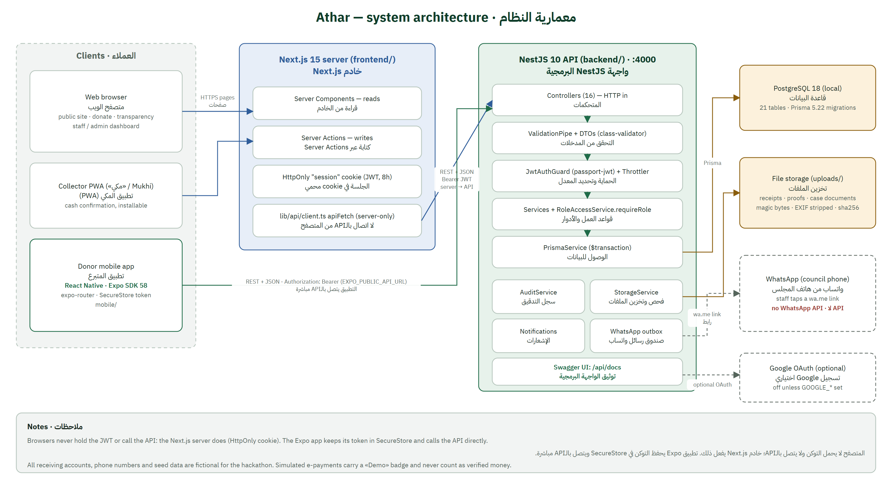
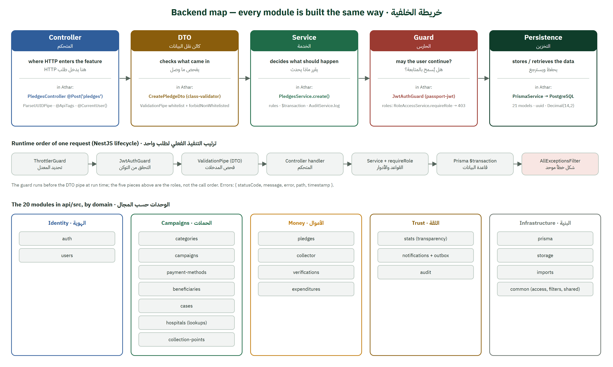
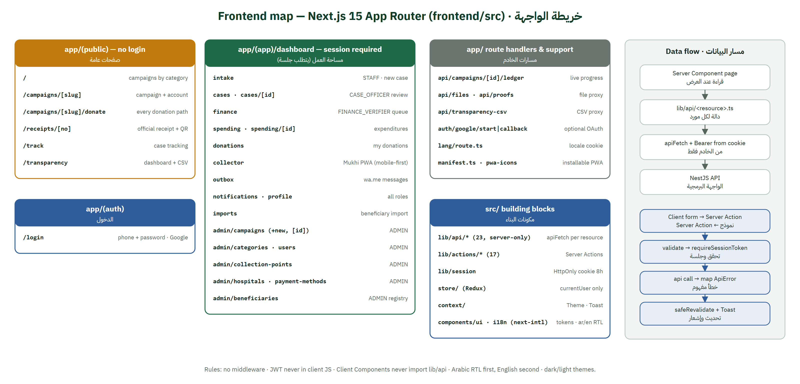
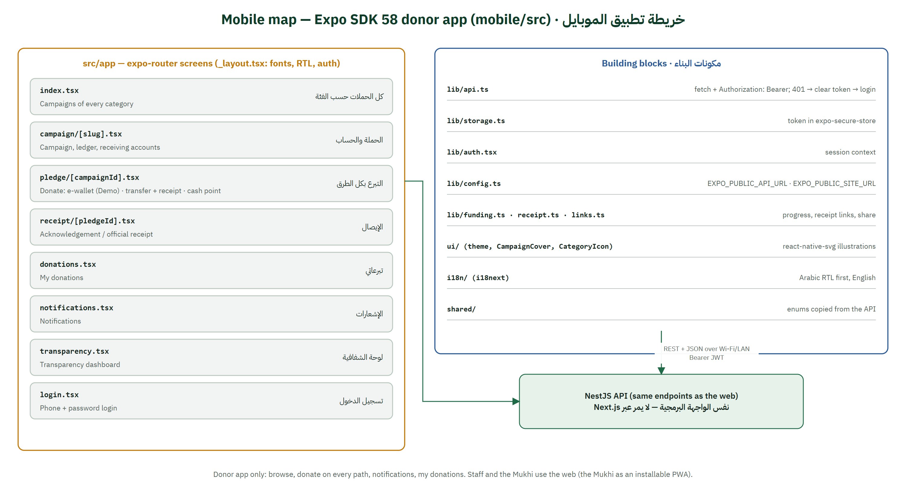
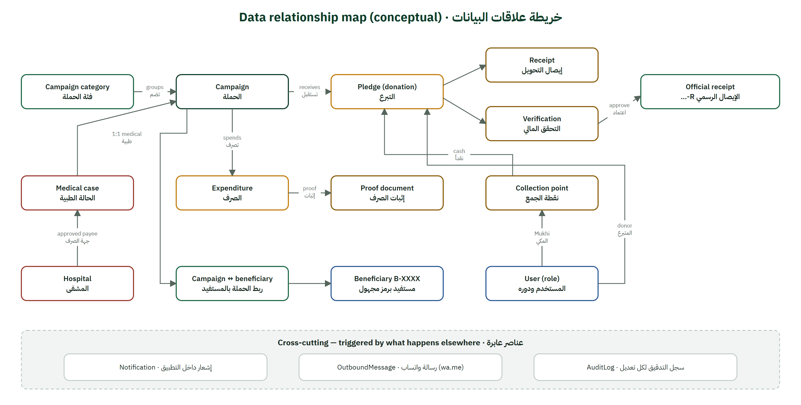
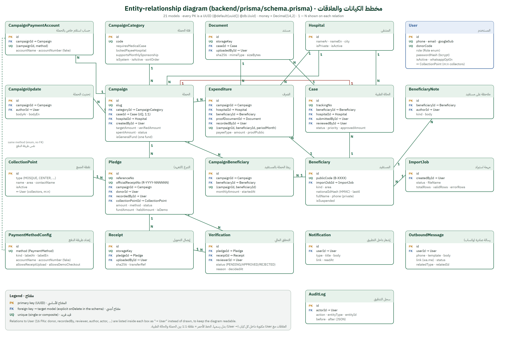
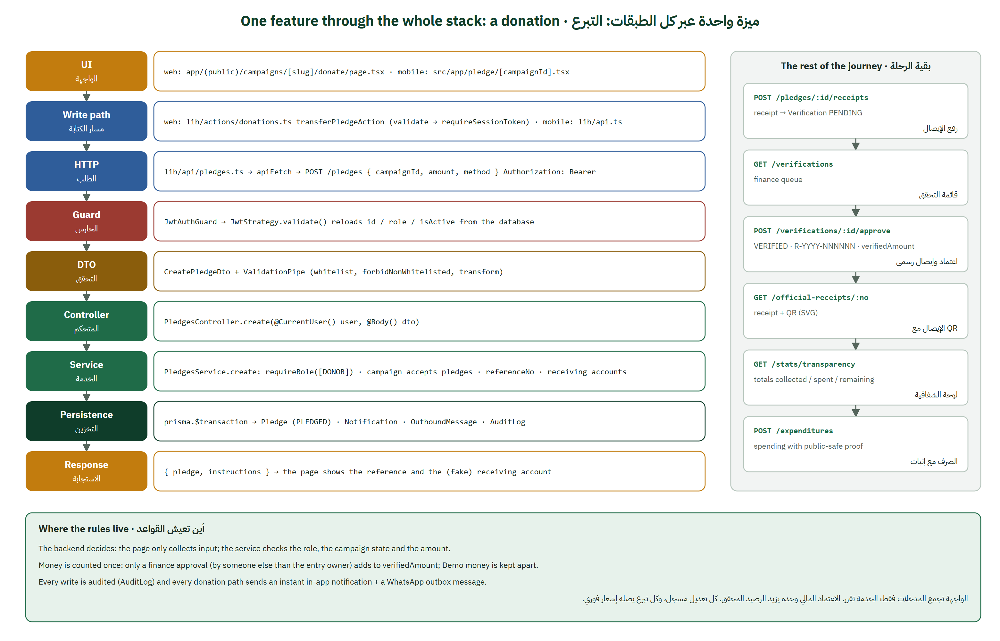
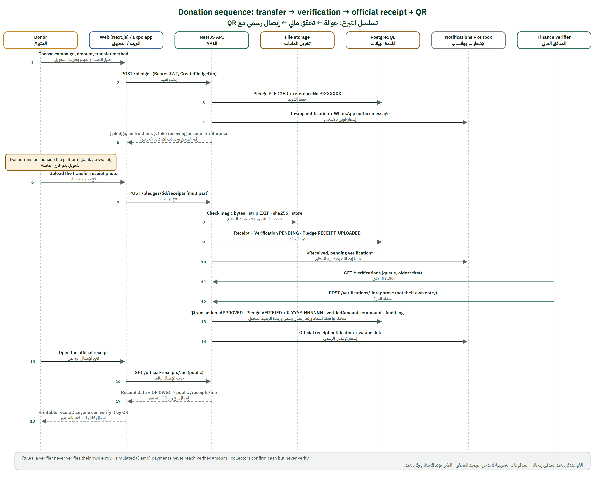
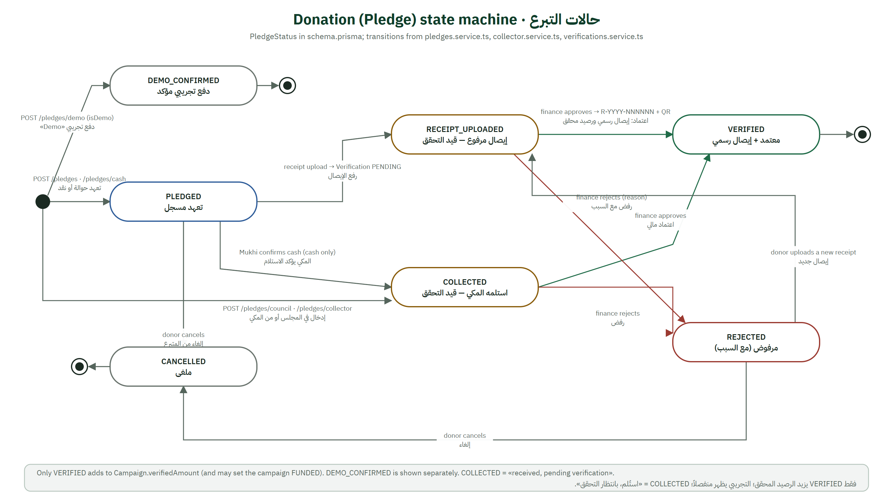

# Athar — System Construction Map

A guide to the system we built for the Local Council of Salamiyah: its pieces, how they connect, the order we built
them in, and how one donation travels through the whole stack. Written in the style of the B4F Board "System
Construction Map", grounded in the real code of `salamiyah-hackathon` (branch `main`, 2026-11-23).

## 1. What are we actually building?

**Athar (أثر)** is the official hackathon idea of team Athar (approved as idea no. 4): *donation automation for the Local Council in
Salamiyah*. It is a working system, not a mock-up:

- The council creates **donation campaigns** in data-driven **categories** (medical aid, orphan sponsorship, home
  renovation, and any category an admin adds) with a **target amount**.
- **Donors** browse campaigns on the web or the **mobile app** and give by bank transfer + receipt photo, local
  e-wallet (simulated, «Demo» badge) or **cash at a collection point** handed to the «مكي» (Mukhi).
- Every donation gets an **instant notification** confirming receipt; after a **finance verifier** approves it, an
  **official receipt** with a QR code.
- A public **transparency dashboard** shows the total collected, what was spent (with public-safe proof) and the
  beneficiaries — by anonymous code `B-XXXX` only, never their identities.

| Part | Technology | Folder |
|---|---|---|
| Backend | NestJS 10 · Prisma 5.22 · PostgreSQL | `backend/` |
| Frontend | Next.js 15 (App Router) · Tailwind 3 · next-intl | `frontend/` |
| Mobile | React Native · Expo SDK 58 · expo-router | `mobile/` |
| Engineering tools | Swagger `/api/docs` · Postman v2.1 · Jest · Vitest · Playwright · Git | `docs/`, `e2e/` |

Swagger, Postman, Git and the tests are tools we use while building the system; they are not parts of the product.

<!-- pagebreak -->

## 2. The whole system map

- **The frontend talks to the backend; the backend owns the rules.** Nothing is trusted because a page sent it: the
  API checks the token, the role, the campaign state and the amount.
- **Browsers never hold the JWT.** The Next.js server keeps it in an HttpOnly cookie and calls the API with
  `apiFetch`. The Expo app keeps its token in SecureStore and calls the same API directly.
- **Every backend module is built the same way** — controller, DTOs, service — so a new area (e.g. a new campaign
  category behaviour) follows a known, safe pattern.
- **WhatsApp without an API:** messages are written to an outbox and sent by staff with one tap on a `wa.me` link.

## 3. What is Athar made of?

| Product piece | Screens | Main endpoints | Main tables |
|---|---|---|---|
| Campaigns by category | public home, campaign page, admin campaigns/categories | `GET /campaigns`, `POST /campaigns`, `/categories` | Campaign, CampaignCategory |
| Campaign account (ledger) | campaign page, mobile campaign screen | `GET /campaigns/:id/ledger`, `/payment-accounts` | Campaign, PaymentMethodConfig, CampaignPaymentAccount |
| Donations | donate page, mobile pledge screen | `POST /pledges`, `/pledges/demo`, `/pledges/cash`, `/pledges/:id/receipts` | Pledge, Receipt |
| Collector («مكي») | collector PWA | `/collector/points`, `/collector/pledges/:id/confirm` | CollectionPoint, Pledge |
| Verification & receipts | finance queue, receipt page | `/verifications/:id/approve`, `/official-receipts/:no` | Verification, Pledge |
| Spending | spending pages | `POST /expenditures`, `/campaigns/:id/expenditures/monthly` | Expenditure, Document |
| Transparency | `/transparency`, mobile screen | `GET /stats/transparency(.csv)` | all of the above (aggregated) |
| Notifications | bell, outbox | `/notifications`, `/outbox` | Notification, OutboundMessage |
| Medical pipeline | intake, cases | `/cases`, `/cases/:id/review`, `/cases/:id/publish` | Case, Beneficiary, Hospital |
| Administration | admin setup screens | `/users`, `/hospitals`, `/collection-points`, `/imports` | User, AuditLog, ImportJob |

<!-- pagebreak -->

## 4. Our construction path

We built backend-first, one vertical slice at a time, each slice in its own branch (`p02`…`p24`), merged into `main`
only with lint + tests + build green:

| Step | Branch | What it added |
|---|---|---|
| 1 | `p02-api-skeleton` | NestJS skeleton on the bootcamp versions, Prisma uuid schema, first migration and seed |
| 2 | `p03-auth-contract` | passport-jwt auth, class-level guards, `RoleAccessService` and authorization specs |
| 3 | `p04-web-skeleton` | Next.js skeleton: session cookie, `apiFetch`, Salamiyah theme, cookie i18n, login |
| 4 | `p05`–`p06` | categories as data, expenditures, beneficiary codes, payment config; campaign ledger API |
| 5 | `p07`–`p09` | public pages, staff workspace + medical pipeline, the Expo donor app |
| 6 | `p10`–`p13` | every donation path, instant notifications + outbox, collector PWA, official receipts with QR |
| 7 | `p14`–`p15` | expenditures with public proofs, monthly sponsorship, the transparency dashboard |
| 8 | `p16` | deterministic demo seed, `demo:reset`, `DEMO.md`, Playwright e2e scenario |
| 9 | `p17`–`p24` | admin setup, campaign lifecycle, trust polish (audit, SLA alerts), light mode, optional Google sign-in, «مكي» naming |

**Why backend first?** The pages need a real contract to talk to; the backend is the trusted authority for every rule
(who may verify, how much may be spent); and the data relationships (campaign → pledge → verification → receipt)
had to exist before the screens that show them.

<!-- pagebreak -->

## 5. Backend map

- **Controller** = where HTTP enters the feature. One module per domain (`backend/src/<domain>/`), public endpoints in
  controllers without the guard, protected ones with `@UseGuards(JwtAuthGuard)` + `@ApiBearerAuth()` on the class.
- **DTO** = checks what came in. `class-validator` + `@ApiProperty` on every field; the global `ValidationPipe`
  rejects unknown fields (`whitelist`, `forbidNonWhitelisted`); ids pass `ParseUUIDPipe`.
- **Service** = decides what should happen: business rules, `prisma.$transaction` for multi-row writes,
  `AuditService.log` on every mutation, notifications on every donation path.
- **Guard** = decides whether the user may continue. `JwtAuthGuard` (passport-jwt) reloads id / role / isActive from
  the database; roles are checked inside services with `RoleAccessService.requireRole` (403), others' resources are
  hidden with 404.
- **Persistence** = stores and retrieves: `PrismaService` → PostgreSQL, 21 models, UUID keys, money as
  `Decimal(14,2)`, schema changes only through migrations.
- Errors always have one shape: `{ statusCode, message, error, path, timestamp }` with stable codes in `message`.

<!-- pagebreak -->

## 6. Frontend map

- Three route groups: `(public)` (no login), `(auth)` (login), `(app)` (session required, checked in the layout — no
  middleware). The Mukhi's pages live under `(app)/dashboard/collector` and install as a PWA.
- **Reads** happen in Server Components through `lib/api/<resource>.ts`; **writes** go through Server Actions in
  `lib/actions/<resource>.ts` (validate → `requireSessionToken()` → API → map `ApiError` → revalidate). Client
  Components never import `lib/api`.
- Redux holds only `currentUser`; Context only Theme and Toast. Arabic RTL first, English second (next-intl, locale in
  a cookie); dark and light themes.

## 7. Mobile map

- Donor app only: browse campaigns of every category, donate on every path, notifications, my donations, the
  transparency screen. Token in `expo-secure-store`, `Authorization: Bearer`, on 401 → clear token → login.
- It uses the same NestJS endpoints as the web; `EXPO_PUBLIC_API_URL` points to the API on the LAN for the demo.

<!-- pagebreak -->

## 8. Data relationship map

A **category** groups **campaigns**; a campaign **receives pledges**; a transfer pledge carries a **receipt** that
goes to **verification**; approval issues the **official receipt** and raises the verified amount. A campaign
**spends** through **expenditures** with a proof document, and links **beneficiaries** by anonymous code. A medical
campaign comes from exactly one **medical case** with an approved **hospital**. **Notifications**, the WhatsApp
**outbox** and the **audit log** are cross-cutting: triggered by what happens elsewhere. The full schema with every
PK and FK is in `docs/diagrams/erd.png`.

<!-- pagebreak -->

## 9. One donation through the whole stack

Already built and tested end to end (Jest, Vitest, Playwright and the Postman runner): the page, the Server Action,
the API client, the guard, the DTO, the controller, the service, the transaction and the response — then the receipt
upload, the finance approval, the official receipt with QR and the transparency totals.

<!-- pagebreak -->

## 10. Donation states and the final destination

**Built for the hackathon:** campaigns by category, every donation path, instant notifications, collector
confirmation, finance verification with official receipts, spending with public proof, the transparency dashboard,
admin setup, the Expo donor app, a deterministic demo seed and an end-to-end test of the judges' scenario.

**Future scope (mentioned only, not built):** food baskets, education support, monthly collection-point box
collection, joint approval, Aga Khan transfers, monthly reconciliation, a real payment gateway and the WhatsApp
Business API.
